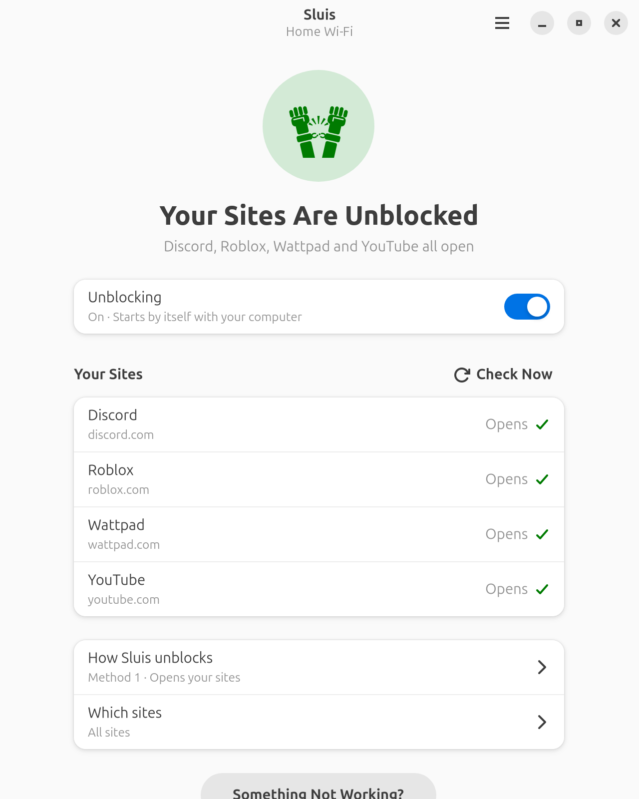
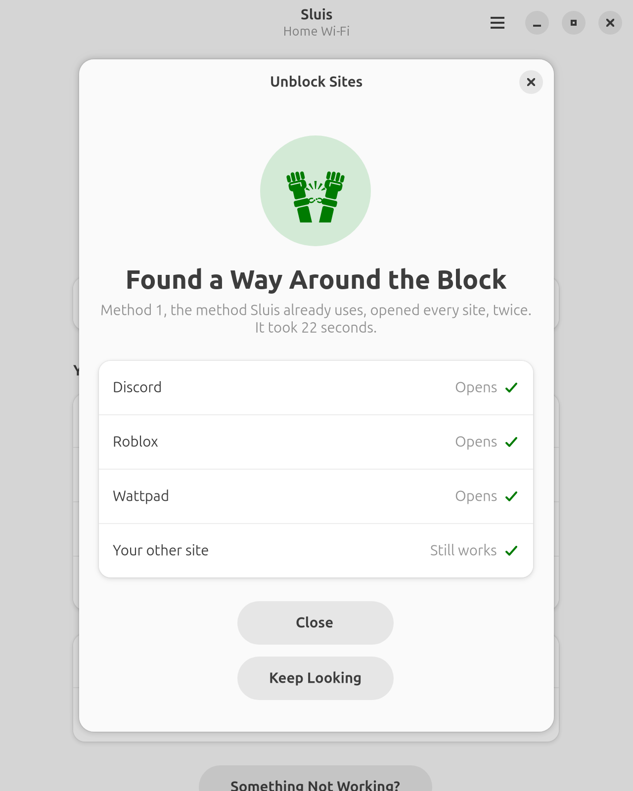
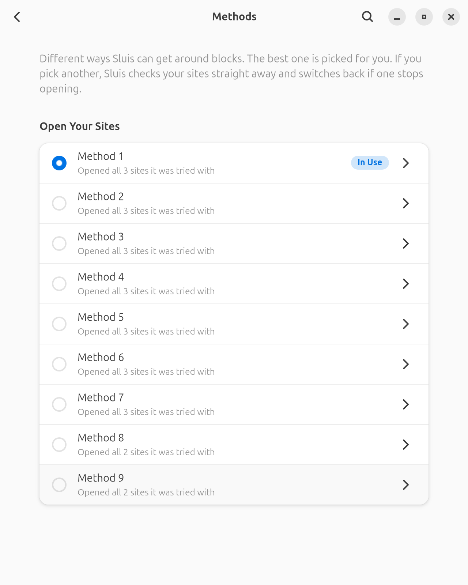
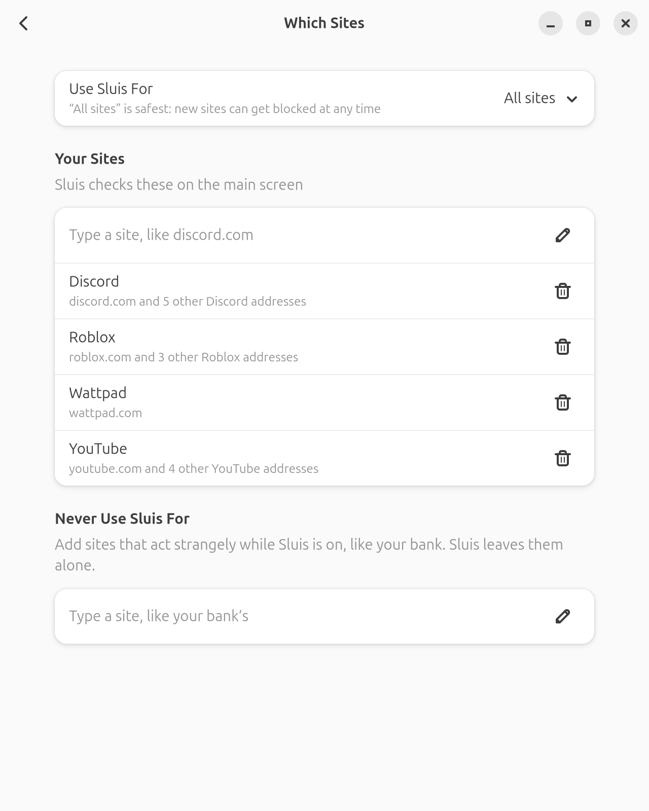

# Using Sluis

Sluis opens websites that your internet provider blocks, like Discord,
YouTube or Wattpad. You don't need to know anything about networks to use it.
This guide shows you how.



## What Sluis does

Some internet providers stop certain websites from opening. Sluis finds a way
around that block on your own internet connection, and keeps it working.

- **It is not a VPN.** Your internet doesn't go through anyone else's
  computer, so it stays as fast as it is now, and nobody else sees what you do.
- **It is free**, and its code is open for anyone to read.
- **It tells you plainly what's going on.** The main screen says whether your
  sites open, and what to do if one doesn't.

Sluis uses a tool called Zapret to do the unblocking. You don't need to set up
Zapret yourself: Sluis installs it for you.

## What you need

- A computer with Linux and the GNOME desktop: Ubuntu 26.04 or newer, or
  Fedora 44 or newer.
- Your computer's password. Sluis asks for it before it changes anything,
  because it changes how your computer reaches websites.

## Installing Sluis

1. Go to [rayytor.github.io/sluis](https://rayytor.github.io/sluis/) and
   download the file for your system: the **.deb** for Ubuntu, the **.rpm**
   for Fedora.
2. Open the file you downloaded. Your Software app opens it.
3. Click **Install** and type your password.

Sluis is now in your list of apps.

### Building it yourself

On other systems, you can build Sluis from its code. Open **Terminal** and
install the tools it needs. On **Fedora**:

```sh
sudo dnf install git cargo meson gtk4-devel libadwaita-devel gettext desktop-file-utils
```

On **Ubuntu**:

```sh
sudo apt install git cargo meson libgtk-4-dev libadwaita-1-dev gettext desktop-file-utils
```

Then build and install it. This takes a few minutes.

```sh
git clone https://github.com/rayytor/sluis.git
cd sluis
meson setup _build --prefix=/usr
meson compile -C _build
sudo meson install -C _build
```

## The first time you open Sluis

Open **Sluis** from your apps. If Zapret isn't on your computer yet, Sluis
welcomes you and offers to set everything up:

1. Click **Get Started**.
2. Type your password when your computer asks for it.
3. Sluis downloads Zapret, checks that the download is genuine, and installs
   it.
4. Sluis then asks which sites don't open for you and looks for a way around
   the block. See [When a site doesn't open](#when-a-site-doesnt-open).

## The main screen

The main screen tells you at a glance whether your sites open.

- **The big message at the top** says how things are, like *Your Sites Are
  Unblocked* or *Discord Is Blocked*. If something needs doing, there's a
  button for it right there.
- **Unblocking** turns Sluis's unblocking on or off. When it's on, it also
  starts by itself when you turn on your computer, even if the Sluis window is
  closed.
- **Your Sites** lists the sites you care about, and whether each one *Opens*
  or is *Blocked*. Click **Check Now** (or press Ctrl+R) to check them again.
- **How Sluis unblocks** shows the method Sluis is using. See
  [Methods](#methods).
- **Which sites** chooses which sites Sluis works on. See
  [Choosing which sites](#choosing-which-sites).

## When a site doesn't open

Click **Unblock It** on the main screen, or **Something Not Working?** at the
bottom of it.

1. **Tell Sluis which sites don't open.** Type a site, like `discord.com`, or
  tick the ones you use from the list of sites that are often blocked.
2. **Choose how long to look.**
   - **Quick** tries the most common ways. It takes about a minute.
   - **Deep** tries everything. It can take up to 30 minutes, so use it only
     if Quick finds nothing.
3. **Click Start**, and type your password if asked. You can keep using your
   computer while Sluis looks. Your internet keeps working as it is while
   Sluis tests.
4. When Sluis finds a way, it shows which of your sites it opens. Click
   **Turn It On** to use it, or **Keep Looking** to try for another.



Sluis also checks that the sites that already worked still work, so a fix for
one site doesn't break another.

### When Sluis can't get around a block

Sometimes the problem isn't one Sluis can fix. Sluis tells you what it found:

- **Your internet provider gives wrong addresses.** Your provider is sending
  your computer to the wrong place for that site. Turning on *secure DNS* in
  your web browser's settings fixes this. In Firefox it's called *DNS over
  HTTPS*; in Chrome it's *Use secure DNS*.
- **The site doesn't answer at all.** The site may be down, or blocked in a way
  Sluis can't get around.
- **The site already opens.** It isn't blocked, so Sluis isn't needed for it.

## Methods

There are many ways to get around a block, and Sluis calls each one a
*method*. Different internet providers need different methods. Open **How
Sluis unblocks** on the main screen to see them all, with the best ones for
your sites first.



To try another method, click it, then click **Use This Method**. Sluis checks
your sites again straight away. If one of them stops opening, Sluis switches
back to the method you had before by itself, and asks whether you want to keep
the new one anyway.

## Choosing which sites

Open **Which sites** on the main screen.



- **All sites** is the safest choice, because a new site can get blocked at
  any time.
- **Only my sites** limits Sluis to the sites on your main screen.
- **Never Use Sluis For** lists sites Sluis should leave alone, like your
  bank's website. Type a site and press Enter to add it.

## At home, at work, on the go

Different networks can need different methods. Sluis remembers which method
works on each Wi-Fi network, and switches to it by itself when you connect
again. You can turn this off in Preferences.

## Preferences

Open the menu (the button with three lines at the top right) and choose
**Preferences**.

- **Start with the computer**: sites open as soon as you log in.
- **Remember each Wi-Fi network**: use the right method by itself at home, at
  work or on mobile data.
- **Tell me when a site stops opening**: Sluis checks your sites quietly every
  hour.
- **Get new methods automatically**: keeps the list of methods up to date.
- **Unblock voice and video calls**: needed for Discord voice chat with some
  internet providers.

Leave the settings under **For Experts** as they are unless someone who knows
Sluis tells you otherwise.

## If something goes wrong

| Sluis says | What to do |
|---|---|
| *Unblocking Is Off* | Turn on **Unblocking** on the main screen. |
| *Can't Reach Zapret* or *Can't reach Sluis's helper* | The part of Sluis that changes settings isn't working. Install Sluis again (see [Installing Sluis](#installing-sluis)). |
| *Zapret stopped with that change, so the previous settings are back* | Nothing is broken: Sluis undid the change. Try another method. |
| *Zapret's settings file is damaged* | Click **Repair**. |

## Removing Sluis

If Sluis installed Zapret for you, open **Preferences** and click **Uninstall
Zapret** first. Sluis only removes what it installed itself.

Then remove Sluis in your Software app, like any other app. If you built it
yourself, go to the folder you built it in and run this in Terminal instead:

```sh
sudo ninja -C _build uninstall
```

## Languages

Sluis is in English and Turkish. It uses your computer's language.

## Getting help

If something doesn't work, you can
[report it](https://github.com/rayytor/sluis/issues). Say which sites don't
open, which internet provider you use, and what Sluis shows.
